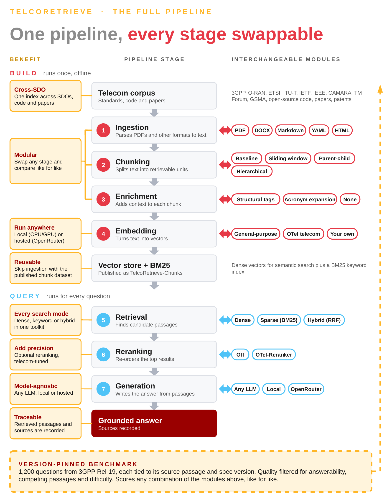

# TelcoRetrieve

[](https://opensource.org/licenses/Apache-2.0)
[](https://www.python.org/downloads/)
[](https://www.gsma.com/solutions-and-impact/technologies/networks/gsma_resources/open-telco-ai/)
[](https://huggingface.co/datasets/GSMA/telco-retrieve-chunks)

An open, vendor-neutral RAG pipeline for telecom specifications: ingest, hybrid search, rerank and answer with sources.

Part of the [GSMA Open Telco AI](https://www.open-telco.ai/).

<p align="center">
  
</p>

---

## Overview

TelcoRetrieve answers natural-language questions about telecom standards. It retrieves the relevant passages from an index you build or download, and the generator answers from those passages and cites them.

```bash
open-telco-rag ask "What does O-RAN WG3 define for the E2 interface?" --source-type oran
open-telco-rag ask "What does 3GPP TS 28.312 define for intent management?" --source-type 3gpp
open-telco-rag ask "What are the ETSI ZSM closed-loop automation requirements?" --source-type etsi
```

The package is `open_telco_rag` and the command is `open-telco-rag`.

---

## Supported Corpora

| Corpus | Source | Format |
|--------|--------|--------|
| O-RAN Alliance | O-RAN R003–R005, all WGs | PDF, DOCX |
| 3GPP | TSpec-LLM dataset, Rel-8 through Rel-19 | Markdown |
| ETSI | ENI, ZSM, MEC, NFV, SAI, F5G, RIS | PDF, YAML |
| ITU-T | All 27 active series (G, Y, Q, X, M…) | PDF |
| CAMARA | Fall25, 75+ API repos | Markdown, YAML |
| GSMA | OPG, IG, AID, SGP, RCS and more | PDF, DOCX |
| TM Forum | TMF Open APIs, ODA Component specs ([tmforum-rand/tmf-otel](https://github.com/tmforum-rand/tmf-otel)) | YAML, JSON |

---

## Pre-built Dataset

The indexed corpus (4.6M+ chunks, 1B+ tokens, 7 standards bodies) is on Hugging Face as [GSMA/telco-retrieve-chunks](https://huggingface.co/datasets/GSMA/telco-retrieve-chunks). Download one corpus or all of it without running ingestion:

```python
from datasets import load_dataset

ds = load_dataset("GSMA/telco-retrieve-chunks", data_files="etsi.jsonl")   # one corpus
ds = load_dataset("GSMA/telco-retrieve-chunks")                            # all corpora
```

---

## Installation

From a clone of this repository (the package is not published on PyPI):

```bash
git clone https://github.com/Znbne/telco-retrieve
cd telco-retrieve
pip install -e ".[local-embed,pdf,docx]"
```

If a release is published, `pip install open-telco-rag[local-embed,pdf,docx]` installs the same extras.

### NVIDIA, AMD ROCm or CPU: install PyTorch first

The `local-embed` extra depends on `torch`. If you install the package first, pip pulls the default PyTorch build from
PyPI, which on Linux is a CUDA build of several GB. That is the wrong build on an AMD GPU and a waste on a machine
without a GPU, and replacing it afterwards means a forced reinstall. So install PyTorch **first**, from the index that
matches your hardware, then the package, then check:

```bash
# 0. A current pip first: a stock pip 22.0.2 crashed on the large torch wheel with "ValueError: Memoryview is too large"
pip install --upgrade pip

# 1. PyTorch first. The index URL names the build; take the exact name for your CUDA or ROCm version from
#    https://pytorch.org/get-started/locally/ (the version numbers below are examples)
pip install torch --index-url https://download.pytorch.org/whl/cu128      # NVIDIA, CUDA 12.8 (cu126, cu130, ... to match your driver)
pip install torch --index-url https://download.pytorch.org/whl/rocm7.2    # AMD, ROCm 7.2 (the index must match the ROCm on the host, see below)
pip install torch --index-url https://download.pytorch.org/whl/cpu        # no GPU

# 2. then the package: it finds torch already installed and leaves it alone
pip install -e ".[local-embed,pdf,docx]"

# 3. check which build you have
python -c "import torch; print('gpu:', torch.cuda.is_available(), '| cuda:', torch.version.cuda, '| hip:', torch.version.hip)"
```

Run `pip install --upgrade pip` before any torch install, then only the line of step 1 that matches your machine. NVIDIA prints `gpu: True | cuda: 12.x | hip: None`. An AMD ROCm
build also answers `torch.cuda.is_available()`, so it prints `gpu: True | cuda: None | hip: 6.x`. A CPU build prints
`gpu: False | cuda: None | hip: None`. If you have a GPU and see `gpu: False`, or the wrong one of `cuda` and `hip`, the wrong
build is installed: run the matching line of step 1 again with `--force-reinstall`.

**ROCm: the index must match the ROCm version on the host.** `rocm-smi` and `rocminfo` show which ROCm and which GPU
(for example `gfx950`) the machine has. A PyTorch ROCm build for a different ROCm version can install without any error
and still see no GPU: with the `rocm6.4` build on a `gfx950` host, the first use of the GPU stopped with "No HIP GPUs are
available", and the host needed the `rocm7.2` build. In that case you would expect `hip:` in the check above to show a version while `gpu:`
is `False`; install the build whose number matches the host (`pip install --force-reinstall torch --index-url
https://download.pytorch.org/whl/rocm<version>`). Which build suits which GPU is listed on the PyTorch page above.

---

## Quick Start

### 1. Configure API keys

Create a `.env` file in your project root:

```bash
OPENROUTER_API_KEY=your_key_here      # for LLM generation via OpenRouter (Llama, Claude, GPT-4o, etc.)
ANTHROPIC_API_KEY=your_key_here       # optional — for direct Claude access
DATALAB_API_KEY=your_key_here         # optional — for Marker PDF preprocessing
```

### 2. Download a corpus

Download O-RAN specifications from [o-ran.org](https://www.o-ran.org/specifications) into `data/oran/`.

**3GPP:** the CLI does not download specs; you supply the files. The Markdown conversions of the 3GPP
specifications are in the TSpec-LLM dataset on Hugging Face (`rasoul-nikbakht/TSpec-LLM`; the id was checked
on 2026-09-30, but verify it and read its terms before use: the dataset is gated, so log in with
`huggingface-cli login` and accept them first). It holds a `.md` and a `.docx` for every spec, and the 3GPP
source ingests **both** extensions, so download only the Markdown:

```bash
pip install huggingface_hub
python -c "from huggingface_hub import snapshot_download; snapshot_download('rasoul-nikbakht/TSpec-LLM', repo_type='dataset', allow_patterns=['3GPP-clean/*.md'], local_dir='data/3gpp')"
open-telco-rag ingest 3gpp --data data/3gpp/3GPP-clean --strategy hierarchical_markdown
```

The layout is `3GPP-clean/Rel-<N>/<NN>_series/<spec>.md`; the release, series, spec number and version come from
those folder and file names (`28312-i11.md` is TS 28.312, Rel-18). Files whose names do not follow that pattern
still ingest but may lack `spec_number`. All releases are millions of chunks: see "Resume" in the [CLI reference](docs/reference/cli.md) and ingest one
release at a time if you want the smallest possible restart unit.

### Preparing the GSMA/3GPP Rel-19 data

`scripts/stage_3gpp.py` downloads the Markdown conversions of the Rel-19 specifications from the
[`GSMA/3GPP`](https://huggingface.co/datasets/GSMA/3GPP) dataset, checks them, and stages them under names that the 3GPP
loader reads: `<out>/Rel-19/<NN>_series/<spec>-<version>.md`. It downloads only `marked/Rel-19/**/raw.md` and
`conversion_log.jsonl`, never the ~32,760 figure images. It is opt-in: the loader and the default behaviour are unchanged.
The files are downloaded from the original source onto your machine; this repository does not contain or redistribute
them. Read the dataset's licence and the 3GPP terms before you use the data.

Install the package first (`pip install -e ".[local-embed,pdf,docx]"` from the repository root, see "Installation"): the
script imports `open_telco_rag`, and without the install it stops with `ModuleNotFoundError`.

```bash
python scripts/stage_3gpp.py --revision a056f6018a7e8e67052aa68a702e272d0ae95d75 --out data/3gpp/staged --dry-run   # plan only
python scripts/stage_3gpp.py --revision a056f6018a7e8e67052aa68a702e272d0ae95d75 --out data/3gpp/staged
python scripts/stage_3gpp.py --revision a056f6018a7e8e67052aa68a702e272d0ae95d75 --out data/3gpp/staged --verify    # offline re-check
open-telco-rag ingest 3gpp --data data/3gpp/staged --model bge-m3 \
  --strategy hierarchical_markdown --chunk-size 2048 --enrichment none --distance-metric cosine \
  --bound-tokens 512 \
  --bound-verify minilm=256,bge=512,bge-m3=512,qwen3-embedding-0.6b=512,embeddinggemma-300m=512 \
  --bound-outliers split
```

**Why the bound.** Without `--bound-tokens`, chunks of the staged set reach about 89,000 tokens and 46.6% of them exceed
minilm's 256-token limit (measured on the Rel-19 set in a GPU test run; I have not re-measured them since). The options
above cut every chunk to at most 512 tokens and, with `--bound-verify ... --bound-outliers split`, cut further any chunk
that is still over another embedder's limit. Repeat the command for each embedder and change only `--model`: the
`--bound-*` options, with the same `--bound-verify` list, must be identical for every embedder, so that all collections
hold identical chunks and their results can be compared.

- `--revision` must be a 40-character commit hash (a branch name is refused), so that everyone stages the same files.
  The one above is the revision the counts below were measured on.
- Expected for that revision: 1,566 conversion-log rows (1,557 OK, 9 ERROR), 1,557 `raw.md` files and 1,557 staged files;
  67 multi-part specs; 20 specs with a `_cover` file name; 49 `.doc` log rows; 7 specs whose first conversion failed and
  a later one worked; one spec with only failed conversions and no file (TS 25.331).
- Stubs: files smaller than `--stub-bytes` (default 5,120 bytes) are flagged `is_stub` in the manifest and still staged.
  8 specs are under 5,000 bytes (38.460, 38.462, 38.461, 25.461, 37.481, 22.242, 25.431, 38.421) and 11 under 5,120 bytes
  (the same eight plus 38.471, 41.101 and 25.421). They hold little more than a cover and a contents list.
- Time and disk: `--dry-run` takes about 6 to 7 minutes, because it lists the whole tree (about 34,000 files, in pages of
  50) to read the size and hash of each spec file; it downloads no spec file. The real run then downloads about 0.73 GB in
  parallel (`--workers`) into `<out>_raw`, next to `--out`, not inside it, so that `ingest --data <out>` never reads it, and
  stages the same again: about 1.5 GB in total. A run that stops can be started again.
- The dataset is public. If you set `HF_TOKEN` in the environment it is used and never printed. A token does not
  prevent HTTP 429 (rate limit) answers: the script, and the Hugging Face library under it, retry with backoff, and the
  retries are counted in `staging_run.json`.
- For each spec the last conversion-log row with status OK decides the version (`38300-j20.docx` is V19.2.0). The
  version is compared with a `V<major>.<minor>.<patch>` string in the first 40 lines of the file; a mismatch is
  counted in the manifest, never an error.
- `manifest.json` records for every file its source path, staged name, size, sha256, version and part, and lists the excluded
  specs. It has no timestamps, no local paths and no run-dependent numbers: for the same revision it is byte-identical
  whether the files were downloaded or staged with `--source` from an already downloaded tree (with the same `raw.md` files
  and log). What differs from run to run (finish time, retry counts, the number of figure files in the listing) is in
  `staging_run.json`.
- `--source DIR` stages from an already downloaded tree with the dataset's layout, offline.

#### Known limitations

- **minilm's 256-token limit sets the chunk size for everyone.** With the verify list above, every collection gets the same
  chunks, cut so that none is over any listed embedder's limit; minilm's 256 is the strictest, so the other models also get
  chunks that are shorter than the 512 tokens they could take. If you do not need minilm, take it out of the list, for
  every embedder.
- **Multi-part specs have no version in the chunk metadata.** The loader allows one suffix after the five digits, so a spec
  with a part (for example `32111-1`) is staged as `32111-1.md`: its chunk metadata has `doc_part` but no `version`; the
  version is only in the manifest. For study reports (`23700-75`) the "part" is a study-item number, marked
  `doc_part_kind: study_item_number` in the manifest (a rule of thumb: spec numbers x.700 to x.899).
- **The cleaning leaves noise.** The cover page and contents list are kept in about 170 specs (the cover pattern is
  deliberately limited to the start of a document), and table separator rows (long runs of `-`) and dot leaders in contents
  tables are not collapsed. They cost tokens, and are why a few chunks are mostly formatting.
- **float16 on a GPU, and EmbeddingGemma.** Embedders load in float16 on a GPU (the default for every key), and
  `embeddinggemma-300m` returned NaN vectors that way in a GPU test. Use the key `embeddinggemma-300m-fp32` for that model on
  a GPU (see "Embedding models and prefixes"). If a batch does contain NaN or infinite values, the run now stops before that
  batch is written, names the chunk ids, and exits with code 4 when you pass `--fail-on-error` (otherwise 0).
- **A failed ingest leaves a header-only CSV.** After such a failure (a NaN batch, for example) the log file
  `logs/ingest_*.csv` has only its header row, although the summary prints the error count: the per-file rows are written only
  after the bulk write succeeds. Use the printed summary and the exit code, not the CSV, to see that a run failed.
- **The OpenRouter numbers come from one 30-file run.** The measured speed, cost and behaviour are in "OpenRouter
  embeddings: measured behaviour and usage notes"; price and rate limits can change, and retries, 429 and partial responses
  were only exercised with a fake HTTP layer, not live.
- **fp32 quality for EmbeddingGemma is untested.** `embeddinggemma-300m-fp32` produced finite vectors for all 19,100 chunks
  of a 30-file run (Chroma and the BM25 index held the same rows), but I have not measured its retrieval quality, or compared
  it with `embeddinggemma-300m` on a CPU.
- **Paths.** The loader reads the release and the series from any `Rel-NN` or `NN_series` folder in the whole path, so do not
  put `--out` below such a folder (the script warns).
- Only Rel-19 has been tested.

### 3. Ingest

```bash
open-telco-rag ingest oran --model bge --data data/oran/
```

Embedding models are listed in the [embedding reference](docs/reference/embedding.md); `bge` is used above.

### 4. Search

```bash
open-telco-rag search "near-RT RIC control loop" --source-type oran --top-k 5
```

### 5. Ask a question

```bash
open-telco-rag ask "What interfaces does the Near-RT RIC expose?" --source-type oran
```

---

---

## Configuration

- API keys and the local endpoint go in `.env` (see `.env.example`).
- Model, chunking and enrichment choices are JSON registries in `configs/`: `embedding_models.json`, `reranker_models.json`, `llm_models.json`, `chunking_strategies.json`, `enrichment_strategies.json`.
- Every command takes its options as flags. `open-telco-rag <command> --help` lists them all.

---

## Commands

```
open-telco-rag ingest <source>        Ingest documents into the vector database
open-telco-rag search <query>         Search the vector database
open-telco-rag ask <question>         Search, then answer with sources
open-telco-rag evaluate <corpus>      Run the evaluation suite
open-telco-rag info                   Show what a database holds
open-telco-rag delete <collection>    Delete a collection
open-telco-rag push-hf, pull-hf       Push or pull a database folder on the Hugging Face Hub
```

---

## TelcoRetrieve Cookbook

The notebooks in [`notebooks/`](notebooks/) are the TelcoRetrieve Cookbook, one per corpus. Each covers ingestion, search, question answering and evaluation. The PDF [Telco-Retrieve-Guidebook.pdf](Telco-Retrieve-Guidebook.pdf) is the Guidebook.

| Notebook | Corpus |
|----------|--------|
| [`01_oran_quickstart.ipynb`](notebooks/01_oran_quickstart.ipynb) | O-RAN Alliance R005 |
| [`02_3gpp_quickstart.ipynb`](notebooks/02_3gpp_quickstart.ipynb) | 3GPP Release 8 through 19 |
| [`03_camara_quickstart.ipynb`](notebooks/03_camara_quickstart.ipynb) | CAMARA Fall25 |
| [`04_tmforum_quickstart.ipynb`](notebooks/04_tmforum_quickstart.ipynb) | TM Forum Open APIs & ODA Components |
| [`05_gsma_quickstart.ipynb`](notebooks/05_gsma_quickstart.ipynb) | GSMA Open Gateway |
| [`06_itu_quickstart.ipynb`](notebooks/06_itu_quickstart.ipynb) | ITU-T |
| [`07_etsi_quickstart.ipynb`](notebooks/07_etsi_quickstart.ipynb) | ETSI ISG groups |

---

## Documentation

- [Reference](docs/reference/): [CLI](docs/reference/cli.md), [chunking](docs/reference/chunking.md), [embedding and reranker models](docs/reference/embedding.md), [evaluation](docs/reference/evaluation.md), [Python API](docs/reference/python-api.md)
- [Architecture](docs/architecture.md) and [project structure](docs/architecture.md#project-structure)
- [Contributing](docs/contributing.md), including helper scripts, tests and how to add a source
- [TelcoRetrieve Challenge](docs/challenge/README.md)
- [Glossary and index](docs/README.md)

## Related

- [telco-qna-generation](https://github.com/Znbne/telco-qna-generation): synthetic QnA generation toolkit for building evaluation datasets
- [TelcoRetrieve Cookbook](https://github.com/Znbne/telcoretrieve-cookbook): worked examples per corpus

## License

Apache 2.0. See [LICENSE](LICENSE).
