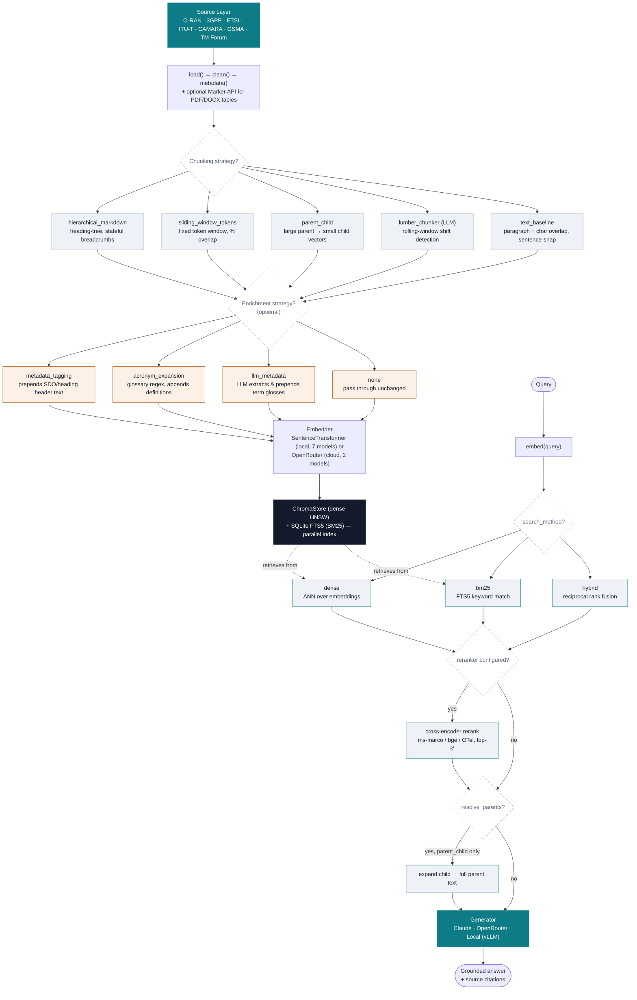

# Figure 1 — Retrieval-Augmented Generation Pipeline

**Source:** `open_telco_rag/core/{pipeline,chunking,enrichment,retrieval}.py`

End-to-end path from a raw SDO document to a cited, grounded answer. Diamonds
are per-request configuration choices, not fixed branches — every
ingest/search call selects one path through each decision point.

